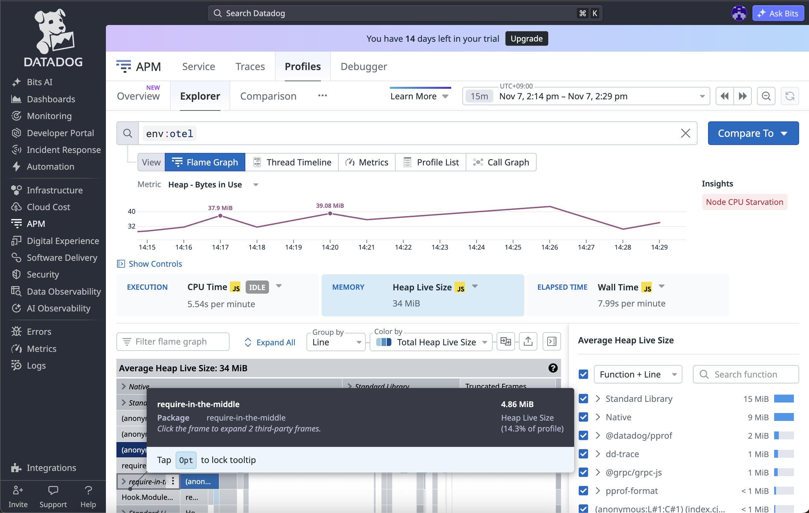

本番環境のアプリケーションで突然のOOM（Out of Memory）。
Datadogのダッシュボードを開いて確認してみたものの、以下のような経験はないでしょうか？

- **プロセスが死んだ直前のメトリクスが綺麗に途切れている**
- **メモリが右肩上がりに増えていることは分かるが、どのコードが原因なのか分からない**

このような「OOM時の手がかりがない」問題に対しては、DatadogのContinuous Profilerによる **Heap Profiling（メモリプロファイリング）** 、そしてそこで確認できる **Heap Live Size** がかなり有効です。

---

## OOMの時、Datadogのメトリクスだけだと原因が分からない

OOMが発生した際、通常のAPMやシステムメトリクス（メモリ使用量など）だけでは調査が行き詰まることがよくあります。

1. 落ちる直前のデータが取れていない

OSのOOM Killerによってプロセスが突然終了させられると、Datadog Agentへメトリクスを送信する前にプロセスが消去されてしまいます。その結果、一番知りたい「死亡直前」のデータが途切れてしまう現象が起きます。

1. メモリが増えたことは見えても「どのコードか」が分からない

仮に死ぬ直前までのグラフが見えたとしても、メトリクスが教えてくれるのは「プロセスの全体的なメモリ使用量」という数値の推移だけです。
「どのコントローラー、どのクラスやメソッドの処理が」「どのオブジェクトをメモリ上に抱え込んでしまったか」というコードレベルの犯人までは特定できません。

---

## Heap Profiling（Heap Live Size）で見えるようになること

ここで役に立つのが、Datadog Continuous Profilerによるメモリのプロファイリング機能です。

1. GCされずに残っているメモリをコード単位で特定

GC（ガベージコレクション）を通過してヒープ上に生き残っているオブジェクトや、アロケーションの傾向をコードのメソッド単位で追跡できます。
「どこがメモリを掴んで離していないか」を把握する手立てになります。

1. プロセスが落ちても、直前のプロファイルは残っている

プロファイラーはバックグラウンドで継続的にプロファイルデータを収集・送信しています。そのため、OOMでプロセスが強制終了した場合でも、死ぬ直前のプロファイルデータがDatadog側にアップロードされていることが多く、クラッシュ直前のメモリ状態を確認できます。

---

## （例）Ruby環境で有効化する設定

普段Rubyがメインではない方でも、環境変数やライブラリ設定を追加するだけで簡単に試すことができます。今回は試しにRuby環境での設定例を紹介します。

1. ライブラリの導入

Gemfileに `datadog` を追加してインストールします。

```ruby
gem 'datadog'
```

2. 環境変数の設定

プロファイラーを有効にするだけでなく、Heap Profiling・Heap Live Sizeの計測に必要なフラグを明示的に有効化します。

```bash
export DD_PROFILING_ENABLED=true
export DD_PROFILING_EXPERIMENTAL_HEAP_ENABLED=true
export DD_PROFILING_EXPERIMENTAL_HEAP_SIZE_ENABLED=true
export DD_SERVICE="your-ruby-app"
export DD_ENV="production"
```

> **参考URL**:
> - [Datadog 公式ドキュメント: Ruby プロファイラーの有効化](https://docs.datadoghq.com/profiler/enabling/ruby/)
> - [Datadog 公式ドキュメント: プロファイルタイプ（Heap Live Size など）](https://docs.datadoghq.com/profiler/profile_types/)

---

## 実際の調査イメージ

Datadogのコンソールで `APM > Profiler` を開き、メモリ系のプロファイルを確認します。



:::message
※ 掲載しているキャプチャ画像は、[Datadog OpenTelemetry Demo](https://docs.datadoghq.com/ja/opentelemetry/getting_started/otel_demo_to_datadog/) を参考に構築した検証用デモ環境のものです。
:::

- **時系列グラフ（メモリ推移）**
  プロセスのメモリ使用量（Heap - Bytes in Use）の時間推移を示しています。右肩上がりに増加しているポイントや、特定の時間帯（例: 14:17や14:20付近）でメモリ消費のピーク（スパイク）が発生している様子をひと目で確認できます。

- **Heap Live Size / Heap Objects の選択**
   画面上部の Metric またはプロファイルタイプで `Heap Live Size` や `Heap - Bytes in Use` を選択することで、GCを通過して現在メモリ上に残っているオブジェクトのサイズを確認できます。

- **Flame Graph（フレームグラフ）の解析**
   画面下部の Flame Graph では、スタックの幅が大きい処理ほどメモリを多く消費（保持）していることを示しています。

- **コードレベルでの特定**
   フレームグラフや右側のリストをクリックすると、スタックトレースとあわせて該当するファイル名や行数、メソッドが特定できます。「巨大なデータの一括読み込み」や「配列への大量蓄積がループ内で起きている」といった原因箇所を特定可能です。
